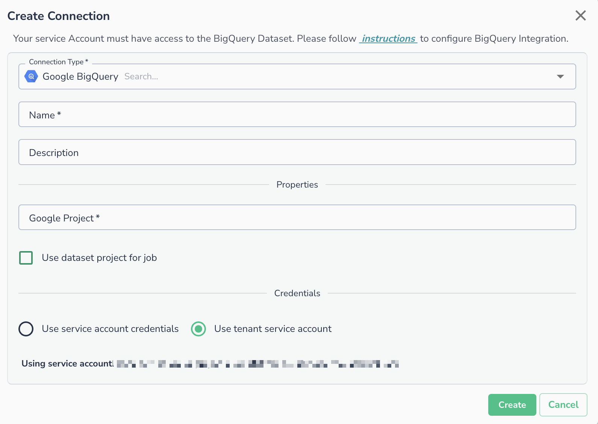
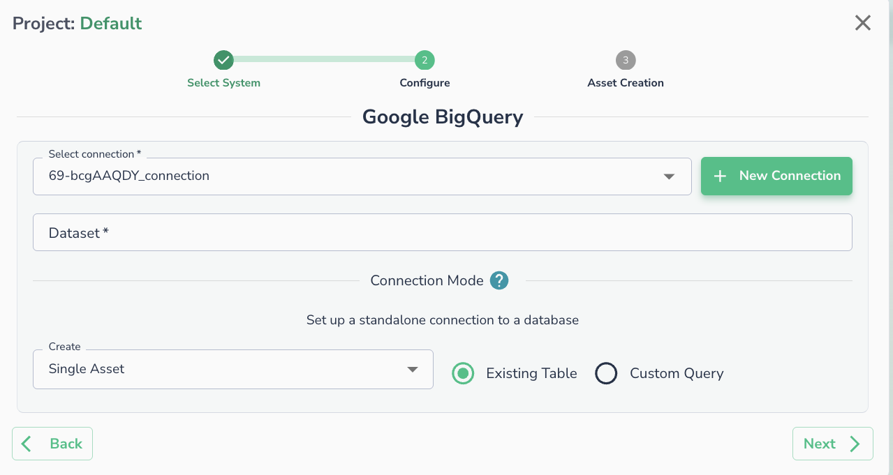

# Google BigQuery

To set up a BigQuery connection, you need to specify the corresponding Google Project name. The Actian Data Observability service account must be granted access to the datasets requiring connections.

## Prerequisites

Before setting up the connection, identify which service account you will use:

* **Tenant service account**: Actian Data Observability's managed (or impersonated) service account. This is only available for GCP deployments. To find your specific tenant service account, open the **Create Connection** dialog and select BigQuery. The service account will be displayed on that page.
* **Your own service account**: if you prefer to provide your own credentials.

This service account must have the right permissions to access and query the data.

### Setting Up Permissions in Google BigQuery

1. Go to Google BigQuery and locate your project: `Google BigQuery / <project> / <dataset>`
2. Click **Share** or **Add Member**.
3. In the **New Member** field, enter the service account identified in the prerequisites above.
4. Assign the roles:
    1. `BigQuery Data Viewer`
    2. `BigQuery Metadata Viewer`
5. Save the settings.

### Setting Up Permissions in GCP Project

The used service account must also be granted `BigQuery Job User` in the GCP project where the query is expected to run.

## Additional Permissions for GCP VPC Deployments

!!! warning
    **This applies only if you use your own service account.** When you select **Use tenant service account**, it already holds this access and there is nothing extra to grant.

On a [GCP VPC deployment](../../../deployment-models/virtual-private-cloud-vpc-deployment.md), Data Observability's Spark job runs as the service account on the connection. If that is your own service account rather than the tenant service account, it also needs the permissions Data Observability's own service account would have had — reading your data is not enough, because the job has to write its results as well.

Grant the following in addition to the read permissions above:

| What it needs to do           | Where to grant it                                | Role                                                  |
| ----------------------------- | ------------------------------------------------ | ----------------------------------------------------- |
| Write scan output and metrics | The Data Observability tenant GCS bucket for your deployment        | `Storage Object Admin` (`roles/storage.objectAdmin`)  |
| Run scan jobs                 | The GCP project where Data Observability runs the scan             | `BigQuery Job User` (`roles/bigquery.jobUser`)        |

!!! warning
    Missing these produces a confusing failure: the connection test passes and the scan still fails, because the test only checks that Data Observability can read your data. The write happens later in the scan.

Ask your Data Observability deployment owner for the tenant GCS bucket name and the project the scan runs in.

## Creating the Connection in Actian Data Observability

BigQuery connections can be used to connect multiple data assets in Actian Data Observability using the same connection parameters. To add a BigQuery connection:

1. Navigate to Actian Data Observability connection page and click the **+ Add Connection** button.
2. In the **Create Connection** dialog, select **Google BigQuery** as the Connection Type.
3. Enter a **Name** for the connection (required) and an optional **Description**.
4. Under **Properties**, enter your **Google Project** name.
    * Optionally, check **Use dataset project for job** if you want the job to run under the dataset's project.
5. Under **Credentials**, select one of the following:
    * **Use service account credentials** - provide your own service account key.
    * **Use tenant service account** - uses the Actian Data Observability-managed service account.
6. Click **Create**.

## Connecting an Asset

Once a connection is defined, you can start using it to create assets. To create assets, you will need:

* Dataset name
* \[Optional] Custom SQL

